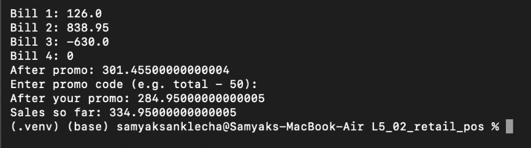
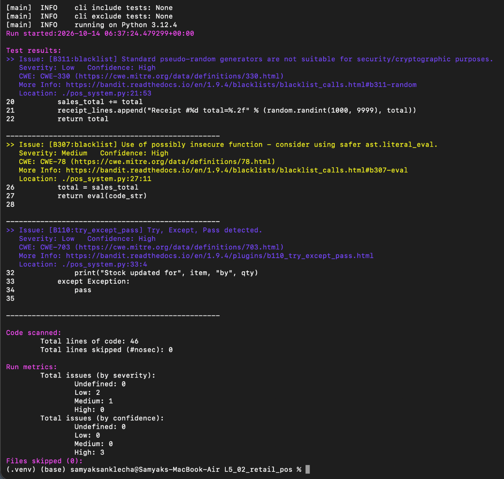
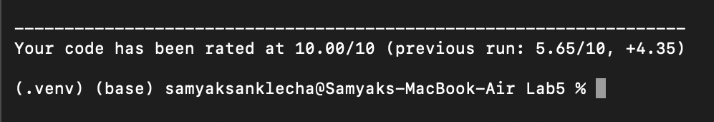

# Lab 5 - Static Code Analysis

**Name:** Samyak Sanklecha
**SRN:** PES2UG24CS436
**Assigned repo:** [L5_02_retail_pos](https://github.com/SETAPESU26/L5_02_retail_pos) (Retail Point of Sale & Discount Tracker)

| File | What it is |
|------|------------|
| `pos_system.py` | Cleaned version of the script |
| `issues.md` | Issue table (15 issues) + before/after scores |
| `reflection.md` | Answers to the reflection questions |
| `PES2UG24CS436_SE_Lab5.pdf` | Short lab report with screenshots |
| `screenshots/` | Terminal screenshots, before and after |
| `reports/before/` | `pylint_report.txt`, `bandit_report.txt`, `flake8_report.txt` on the original file |
| `reports/after/` | Same three reports on the fixed file (`flake8_report.txt` is empty = no issues) |

Result: Pylint 5.65 → **10.00/10**, Bandit 3 → **0**, Flake8 12 → **0**.

Fixes are split into one commit per tool (Bandit, Flake8, Pylint) plus one for logic bugs the tools didn't catch. See the commit history.

## Screenshots

### Before

Running the original script (bill 3 is -630, bill 4 is 0):



Pylint 5.65/10:


Bandit, 3 issues (eval is Medium):



Flake8, 12 issues:


### After

Bad bills get rejected with a reason:


Pylint 10.00/10:



Bandit, no issues:


Flake8, clean:


Commits:


## Run it

```bash
python3 -m venv venv && source venv/bin/activate
pip install pylint bandit flake8
python pos_system.py
pylint pos_system.py
bandit -r pos_system.py
flake8 pos_system.py
```
