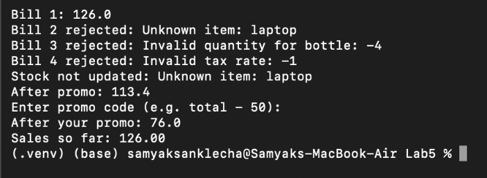
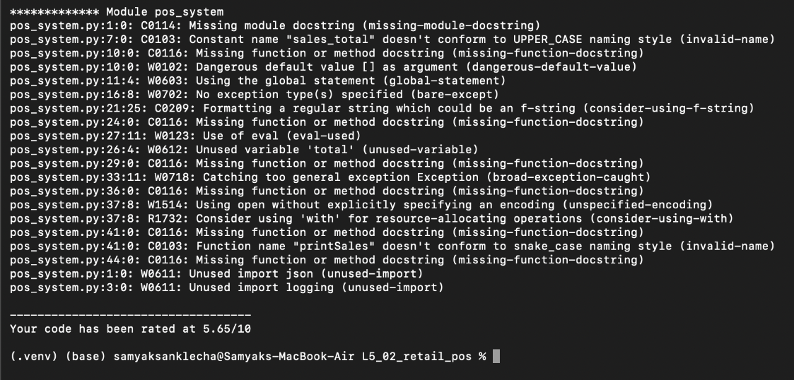
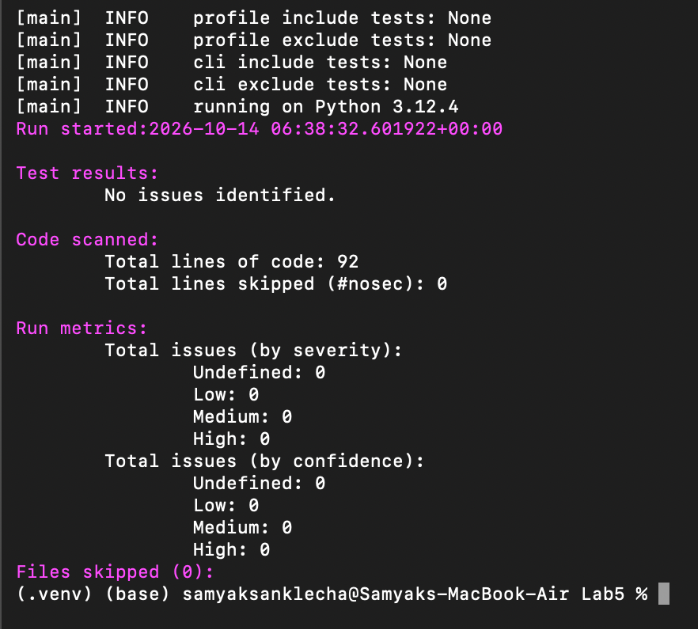
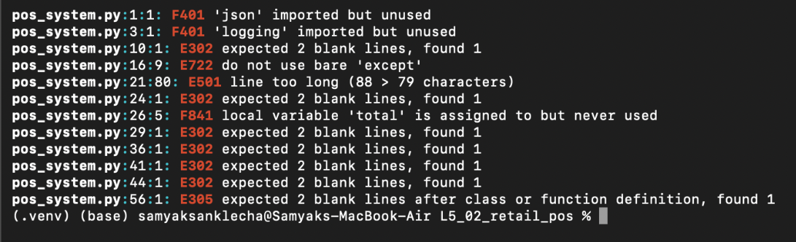
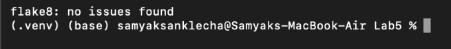
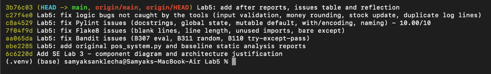

# Lab 5 - Static Code Analysis

**Name:** Samyak Sanklecha
**SRN:** PES2UG24CS436
**Assigned repo:** [L5_02_retail_pos](https://github.com/SETAPESU26/L5_02_retail_pos) (`pos_system.py`, retail point of sale)

| Tool | Before | After |
|------|--------|-------|
| Pylint | 5.65/10 | **10.00/10** |
| Bandit | 3 issues (1 Medium, 2 Low) | **0** |
| Flake8 | 12 issues | **0** |

## Folder

```
Lab5/
├── before/                  original code
│   ├── pos_system.py
│   ├── pylint_report.txt
│   ├── bandit_report.txt
│   ├── flake8_report.txt
│   └── screenshots/
├── after/                   fixed code
│   ├── pos_system.py
│   ├── pylint_report.txt
│   ├── bandit_report.txt
│   ├── flake8_report.txt    (empty = no issues)
│   └── screenshots/
├── issues.md                issue table + how each one was fixed
└── PES2UG24CS436_SE_Lab5.pdf
```

Fixes are in separate commits: one for Bandit, one for Flake8, one for Pylint, and one for logic bugs the tools didn't catch.

## Before vs After

### Running the program

Before: bill 3 is -630, bill 4 is 0, and laptop (not in the price list) gets billed at 0.


After: bad bills get rejected with a reason.



### Pylint

Before: 5.65/10



After: 10.00/10


### Bandit

Before: 3 issues. B307 `eval` (Medium), B311 `random` (Low), B110 try/except/pass (Low)


After: no issues



### Flake8

Before: 12 issues (blank lines, unused imports, bare except, long line)



After: clean



### Commits



## Run it

```bash
pip install pylint bandit flake8
cd after
python pos_system.py
pylint pos_system.py > pylint_report.txt
bandit -r pos_system.py > bandit_report.txt
flake8 pos_system.py > flake8_report.txt
```
